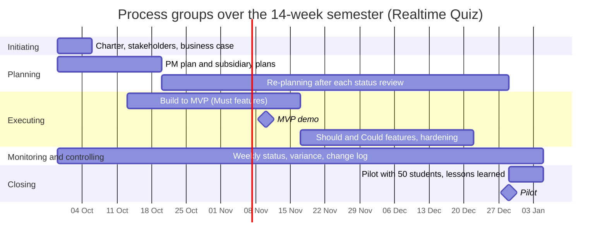

# Process groups across the 14 weeks

Week 1 starts on 2026-09-29. Week n starts 7 x (n - 1) days later. The groups overlap and repeat: they are not phases.

| Process group              | Weeks active                                                                                 | Main activities                                                                                               | Outputs                                                     | Lab that produces them              |
| -------------------------- | -------------------------------------------------------------------------------------------- | ------------------------------------------------------------------------------------------------------------- | ----------------------------------------------------------- | ----------------------------------- |
| Initiating                 | 1 (gate again at week 13 for pilot readiness)                                                | Charter, stakeholder register, business case, sponsor approval                                                | project-charter.md, stakeholders.csv, business-case.md      | Lab-01                              |
| Planning                   | 1-3 first burst; 4-13 continuing re-planning                                                 | PM plan and subsidiary plans (scope, schedule, budget, risk, communication); re-plan after each status review | Project management plan, updated schedule and risk register | Lab-01 (first inputs), later labs ⚠ |
| Executing                  | 3-12 (build to MVP in 3-7, Should and Could features and hardening in 8-12), pilot run in 14 | Build Must features, MVP demo, build Should and Could features, load tests, prepare pilot                     | Working platform, MVP demo, release candidate               | Later labs ⚠                        |
| Monitoring and controlling | 1-14                                                                                         | Weekly status, variance against 490 h and 200 USD, change log, risk review, quality checks                    | Status reports, change log, updated risk register           | Later labs ⚠                        |
| Closing                    | 14 (pilot and closure); handover prepared in 13                                              | Pilot with 50 students, acceptance, lessons learned, handover to operations                                   | Pilot report, lessons learned, handover pack                | Later labs ⚠                        |

## Process groups over the semester

## Phase gates

At three points the sponsor decides whether to continue, change or stop. Each decision needs evidence that the project is still worth doing, which is PRINCE2's continued business justification.

- **Week 1, charter approval (29 Sep 2026).** The sponsor signs the charter. Evidence: the charter with five measurable objectives, the 490 h and 200 USD budget, the stakeholder register, and business-case.md showing option C pays back in about 1.1 years.
- **Week 7, MVP demo (10 Nov 2026).** Evidence: a live demo of the full quiz flow (JSON upload, join, answer, live scores) with 0 blocking defects, effort and cash spent against the budget, and the updated risk register. If the demo fails, the business case's review gate applies: buy option B for the next semester and treat the build as a two-semester project.
- **Week 13, pilot readiness (22 Dec 2026).** Evidence: load test passed (latency <= 500 ms at the 95th percentile, 100 concurrent participants), release candidate with defects fixed, deployment checklist and docker-compose.prod.yml delivered to IT operations, the one-page data description approved by the data protection officer (who can block the pilot), and 50 pilot students confirmed. If any item is missing, the sponsor decides whether to postpone, reduce the scope of the pilot, or stop.
