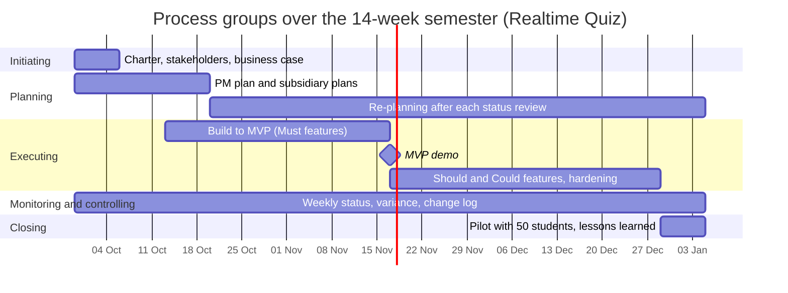

# Process Groups Mapping: Realtime Quiz Project

## 1. Process Groups Across the 14-Week Semester

| Process group              | Weeks active                                                  | Main activities                                                                                                                         | Outputs                                                                                 | Lab that produces them                        |
| -------------------------- | ------------------------------------------------------------- | --------------------------------------------------------------------------------------------------------------------------------------- | --------------------------------------------------------------------------------------- | --------------------------------------------- |
| Initiating                 | Week 1                                                        | Define project mandate, draft charter, identify initial stakeholders, establish business case justification                             | Project charter, stakeholder list, business case                                        | Lab-01                                        |
| Planning                   | Weeks 1–3 (initial burst); Weeks 4–14 (rolling re-planning) | Develop WBS, schedule baseline, budget estimation, risk management plan, architecture design, re-planning after sprint reviews          | Project management plan, WBS dictionary, schedule baseline, risk register               | Labs 02, 03, 04, 05, 06, 07, 08               |
| Executing                  | Weeks 3–13                                                   | Core feature development (auth, quiz authoring, WebSocket sync, live scoring, analytics, UI polish), Docker containerization            | Working software increments, tagged milestone releases, MVP build, test suites          | Labs 07, 08, 09, 10                           |
| Monitoring and controlling | Weeks 1–14                                                   | Track schedule and cost variances, manage change requests, monitor sprint velocity, assess technical risks, maintain quality gates      | Weekly status reports, EVM metrics, change log, CI test pass reports                    | Labs 05, 06, 09 (tools); every lab (practice) |
| Closing                    | Weeks 13–14                                                  | Rehearse and conduct 50-student live pilot, execute runbook handover to IT operations, capture lessons learned, formal project sign-off | Pilot evaluation report, operational runbook, final repository release, lessons learned | Labs 13, 14                                   |

## 2. Process Groups over the Semester

## 3. Phase Gates

The project incorporates three formal phase gates where the Sponsor evaluates continued business justification and decides whether to continue, adjust scope, or terminate the project:

1. **Phase Gate 1: Charter Approval & Initiation (Week 1)**

   - **Decision:** Authorize project commencement and commit the 200 USD cash budget, Linode VPS hosting, and 490 person-hours of effort.
   - **Required Evidence:** Formally signed project charter ([project-charter.md](file:///c:/Users/USer/Documents/techno/ITSM_ITSoftwareMananagement/pm-plan-CheaSeavhong/lab01/project-charter.md)), complete stakeholder register ([stakeholders.csv](file:///c:/Users/USer/Documents/techno/ITSM_ITSoftwareMananagement/pm-plan-CheaSeavhong/lab01/stakeholders.csv)), and quantified business case ([business-case.md](file:///c:/Users/USer/Documents/techno/ITSM_ITSoftwareMananagement/pm-plan-CheaSeavhong/lab01/business-case.md)) confirming an acceptable 1.09-year payback period.
2. **Phase Gate 2: MVP Demonstration (Week 7)**

   - **Decision:** Determine whether in-house software development continues into advanced features (analytics, media, hardening) or is halted in favor of switching to commercial SaaS (Option B) for the following semester.
   - **Required Evidence:** Live demonstration of all core Must features (quiz authoring, live session hosting, authoritative timer, instant scoring, and live WebSocket leaderboard) functioning with zero critical defects, delivered within the 490-hour effort and 200 USD budget ceilings.
3. **Phase Gate 3: Pilot Readiness (Week 13)**

   - **Decision:** Authorize deployment to production for the 50-student live classroom pilot session in week 14.
   - **Required Evidence:** Green load test report demonstrating 100 concurrent simulated students with message broadcast latency <= 500 ms, formal data privacy approval signed by the Data Protection Officer (S08), operational runbook and deployment checklist handed over to IT operations (S06), and verified production Docker Compose deployment on the Linode VPS.
