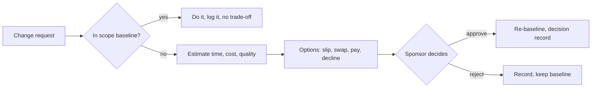

# Change requests · Realtime Quiz · trade-off analysis
Capacity 40 h/week · contingency 56 h · paid capacity 12 USD/h
Fixed sides: C-01 pilot in week 14 · C-02 capacity 4 x 10 h/week · C-03 cash budget 200 USD

## CR-01 · Add chat (F14, 40 h) to the Must scope · requested by sponsor
Time impact of the raw request: 40 h / 40 h per week = 1 week.
Must share would rise from 300/504 = 59.5 % to 340/504 = 67.5 %, above the 60 % guideline.

| Option | Time impact | Cost impact | Quality impact | Fixed side? |
|--------|-------------|-------------|----------------|-------------|
| A slip the pilot | +1 week (40/40) | 0 USD | Scope intact, but the pilot date moves | violates C-01 |
| B swap: defer F13 multimedia (24 h) + F16 question bank (30 h) = 54 h | +0 weeks | 0 USD; 14 h returns to contingency | No multimedia or question bank; chat adds WebSocket load, so the broadcast under 500 ms target must be retested | ok |
| C pay: TA 40 h | +0 weeks | 40 x 12 = 480 USD | Scope intact | violates C-03 |

**Recommendation:** B. A is rejected because it moves the fixed pilot date by a week. C is rejected because 480 USD is 2.4 times the whole cash budget.

## CR-02 · Anonymous joining (F15, 12 h) · requested by student representative
Time impact of the raw request: 12 h / 40 h per week = 0.3 weeks.

| Option | Time impact | Cost impact | Quality impact | Fixed side? |
|--------|-------------|-------------|----------------|-------------|
| A absorb in contingency | +0 weeks | 0 USD (56 -> 44 h buffer) | Buffer shrinks 21 %, less room for the risk of WebSocket rework | ok |
| B swap: defer F13 multimedia (24 h) | +0 weeks | 0 USD; 12 h returns to contingency | No multimedia; PM manages the 50 pilot accounts by SQL script | ok |
| C pay: TA 12 h | +0 weeks | 12 x 12 = 144 USD | Scope intact | violates C-03 (144 USD > 85 USD reserve) |
| D slip the pilot | +1 week (12/40 rounded up) | 0 USD | Scope intact | violates C-01 |

**Recommendation:** B. A is rejected because it spends buffer that CR-01 or a risk may need. C is rejected because it exceeds the 85 USD reserve line. D is rejected because it moves the fixed pilot date.

## CR-03 · Semester shortened by 2 weeks: pilot in week 12 · requested by dean
Capacity lost: 2 weeks x 40 h = 80 h -> new capacity 12 x 40 = 480 h
Contingency lost: 56 h -> 48 h (10 % of 480 h), so 8 h disappear
Planned work 504 h exceeds capacity 480 h by 24 h before any risk.

| Option | Time impact | Cost impact | Quality impact | Fixed side? |
|--------|-------------|-------------|----------------|-------------|
| A drop the whole Could class (F13 24 + F14 40 + F15 12 + F16 30 = 106 h) | 0 weeks | 0 USD; planned 398 h vs 480 h, buffer 82 h | All Must and Should intact; no multimedia, chat, anonymous join, or question bank | ok |
| B keep scope, pay TA 72 h (24 h gap + 48 h contingency) | 0 weeks | 72 x 12 = 864 USD | Scope intact | violates C-03 |
| C keep scope, pilot stays in week 14 | +2 weeks | 0 USD | Scope intact | violates the dean's new date constraint |

**Recommendation:** A. It restores an 82 h buffer, larger than the original 56 h, and touches no Must or Should feature. B is rejected because 864 USD is over four times the cash budget. C is rejected because the date is the dean's decision, not ours.

## Process
