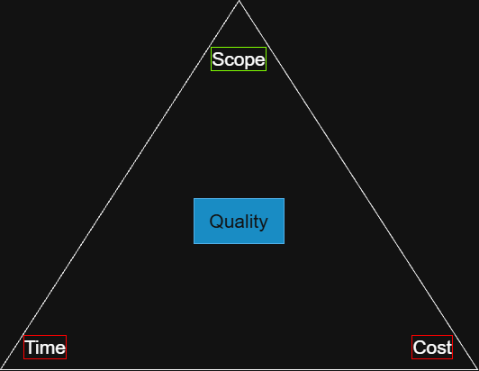

# Constraint analysis · Realtime Quiz · v0.1

| Constraint | Fixed or flexes | Evidence (quote, source) | If violated |
|------------|-----------------|--------------------------|-------------|
| Time | **FIXED (driver)** | "Go-live is a pilot with 50 students in week 14" (charter, Milestones); the 14-week semester ends with the pilot | No pilot means the sponsor cannot observe the promised result and the team cannot complete the capstone deliverable |
| Cost | **FIXED** | "Cash budget 200 USD" (lab recap, Budget); the team has no approved funding above this cap | Hosting, domain, or tool costs above the cap cannot be approved and create an unfunded project |
| Scope | **FLEXES** | `features.csv`: 8 Must, 5 Should, and 4 Could features; the 5 Should plus 4 Could items total **204 h** of negotiable work out of **504 h** planned | Should and Could features move to Won't or are deferred; the Must-feature MVP remains protected |
| Quality | **FIXED FLOOR** | "Broadcast under 500 ms", "WCAG AA", and "CI green" (lab-01 NFR table and Definition of Done) | A quality gate fails, so the pilot is unsafe or unusable and the release cannot be accepted |
| Resources | **FIXED** | "4 students x 10 h/week = 40 h/week" (lab recap, Resources), with the supervising lecturer at 2 h/week | There is no replacement capacity; work must be resequenced or flexible scope removed |
| Risk | **FLEXES (response)** | "Campus Wi-Fi and network infrastructure permit outgoing and incoming WebSocket traffic" (charter, Assumptions); fallback and mitigation responses can be selected as uncertainty changes | An unmitigated risk can cause latency, access, or schedule failure; the response and affected scope must be adjusted |

## Project shape

Realtime Quiz is a **fixed-date, fixed-budget** project: the week-14 pilot is the driver and gives first.
Cost is the second fixed side because the cash ceiling is 200 USD and has no approved overrun.
Scope absorbs surprises through the Should and Could classes: **204 h (40% of 504 h planned work)** can be deferred or removed while the 8 Must features remain protected.

## Quality floor (never traded)

1. Real-time broadcast latency must be **under 500 ms at the 95th percentile** across clients.
2. The user interface must meet **WCAG AA** accessibility requirements.
3. Automated quality assurance must maintain **at least 80% line coverage and zero broken CI builds on main**.

