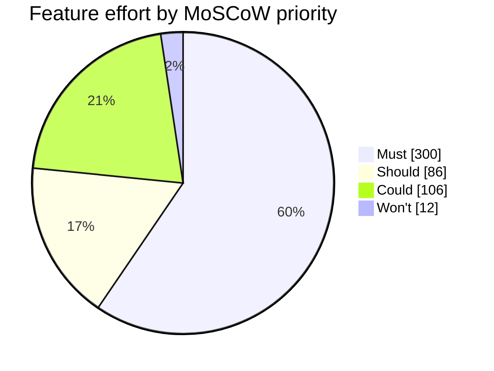

# Task 2: MoSCoW Prioritization

## 1. Prioritization rules

The team prioritized features for the Week 14 pilot with 50 students.

- Must: The pilot cannot work or meet an essential requirement without it.
- Should: Important, but a workaround is possible for the pilot.
- Could: Useful but can be delayed if time is limited.
- Won't: Not included in the Week 14 pilot.

## 2. Feature prioritization

| Id  | Feature                                       | Plan class | Mine   | Estimate (h) | Justification                                                                                                        |
| --- | --------------------------------------------- | ---------- | ------ | -----------: | -------------------------------------------------------------------------------------------------------------------- |
| F01 | Create quizzes with multiple-choice questions | Must       | Must   |           44 | Must: without quiz authoring the pilot is cancelled; test by creating and saving a quiz with multiple questions.     |
| F02 | Students participate in real time             | Must       | Must   |           52 | Must: without live participation the pilot is cancelled; test with 50 students joining and answering.                |
| F03 | Instant feedback and scoring                  | Must       | Must   |           28 | Must: immediate scoring is essential to the live learning objective; test whether answers receive correct scores.    |
| F04 | Leaderboards                                  | Must       | Must   |           24 | Must: the pilot requires live result ranking; test whether the leaderboard ranks students correctly.                 |
| F05 | Real-time updates over WebSocket              | Must       | Must   |           48 | Must: F02 depends on WebSocket updates, so losing it cancels the live pilot; test message delivery during a session. |
| F06 | Authentication and roles                      | Must       | Must   |           44 | Must: controlled access is required for the pilot; test login and role permissions.                                  |
| F07 | Timer per question                            | Must       | Must   |           28 | Must: timed questions are part of the pilot flow; test whether each question ends at its time limit.                 |
| F08 | Multiple concurrent sessions                  | Must       | Must   |           32 | Must: separate sessions are required for the planned use; test two sessions running at the same time.                |
| F09 | Responsive design                             | Should     | Should |           20 | Should: students can use a supported desktop browser as a workaround; test the main pages on desktop and mobile.     |
| F10 | Analytics and reporting                       | Should     | Should |           30 | Should: instructors can review scores manually for one pilot; test whether basic session results can be viewed.      |
| F11 | Export results to CSV and PDF                 | Should     | Should |           24 | Should: instructors can copy results into a spreadsheet; PDF is cosmetic for the pilot.                              |
| F12 | Real-time notifications                       | Should     | Should |           12 | Should: teachers can announce updates verbally; test whether a notification appears when an event occurs.            |
| F13 | Multimedia in questions                       | Should     | Could  |           24 | Could: text-only questions are sufficient for the pilot; images can follow in a later release.                       |
| F14 | Chat during sessions                          | Could      | Could  |           40 | Could: students can communicate verbally during the pilot; test the quiz without chat.                               |
| F15 | Anonymous joining with nickname               | Could      | Could  |           12 | Could: students can use assigned accounts instead; test joining with normal student accounts.                        |
| F16 | Question bank shared between quizzes          | Could      | Could  |           30 | Could: teachers can create questions separately for one pilot; test quiz creation without a shared bank.             |
| F17 | Admin role and user management                | Could      | Won't  |           12 | Won't: the PM can prepare 50 pilot accounts with a controlled script; no admin screen is needed for this pilot.      |

## 3. Priority totals

| Priority | Features | Hours | Percentage |
| -------- | -------: | ----: | ---------: |
| Must     |        8 |   300 |      59.5% |
| Should   |        4 |    86 |      17.1% |
| Could    |        4 |   106 |      21.0% |
| Won't    |        1 |    12 |       2.4% |
| Total    |       17 |   504 |       100% |

Must percentage = (300 / 504) × 100 = 59.5%.

The Must effort is below the 60% limit. This leaves 204 hours of Should and Could work that can be negotiated if the fixed pilot date is at risk.

## 4. Changes from the original plan

- F13 Multimedia in questions changes from the original Should class to Could because text-only questions are acceptable for the pilot.
- F17 Admin role and user management changes from the original Could class to Won't because the project manager can prepare the 50 pilot accounts using a controlled database script.

## 5. MoSCoW effort chart

