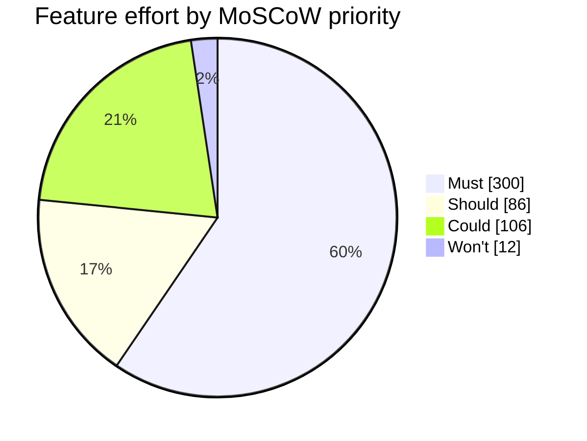

# Task 2: MoSCoW Prioritization

## 1. Prioritization rules

The team prioritized features for the Week 14 pilot with 50 students.

- Must: The pilot cannot work or meet an essential requirement without it.
- Should: Important, but a workaround is possible for the pilot.
- Could: Useful but can be delayed if time is limited.
- Won't: Not included in the Week 14 pilot.

## 2. Feature prioritization

| ID  | Feature                                       | Hours | Priority | Justification                                                                                                                 |
| --- | --------------------------------------------- | ----: | -------- | ----------------------------------------------------------------------------------------------------------------------------- |
| F01 | Create quizzes with multiple-choice questions |    44 | Must     | The teacher must create quizzes; test by creating and saving a quiz with multiple questions.                                  |
| F02 | Students participate in real time             |    52 | Must     | Students must answer during a live session; test with 50 students joining and answering.                                      |
| F03 | Instant feedback and scoring                  |    28 | Must     | Students need their scores after answering; test whether answers receive correct scores.                                      |
| F04 | Leaderboards                                  |    24 | Must     | The pilot needs to display competition results; test whether the leaderboard ranks students correctly.                        |
| F05 | Real-time updates over WebSocket              |    48 | Must     | Live answers and results must update; test message delivery during a session.                                                 |
| F06 | Authentication and roles                      |    44 | Must     | Teachers and students need appropriate access; test login and role permissions.                                               |
| F07 | Timer per question                            |    28 | Must     | Timed questions are part of the pilot quiz flow; test whether each question ends at its time limit.                           |
| F08 | Multiple concurrent sessions                  |    32 | Must     | The system must support separate sessions; test two sessions running at the same time.                                        |
| F09 | Responsive design                             |    20 | Should   | Students can use a supported desktop browser as a workaround; test the main pages on desktop and mobile.                      |
| F10 | Analytics and reporting                       |    30 | Should   | Teachers can review scores manually for the pilot; test whether basic session results can be viewed.                          |
| F11 | Export results to CSV and PDF                 |    24 | Should   | Results can be copied into a spreadsheet and saved manually; test CSV export, with PDF treated as a later enhancement.        |
| F12 | Real-time notifications                       |    12 | Should   | Teachers can announce updates verbally; test whether a notification appears when an event occurs.                             |
| F13 | Multimedia in questions                       |    24 | Could    | Text-only questions are sufficient for the pilot; test quiz creation using text questions.                                    |
| F14 | Chat during sessions                          |    40 | Could    | Students can communicate verbally during the pilot; test the quiz without chat.                                               |
| F15 | Anonymous joining with nickname               |    12 | Could    | Students can use their assigned accounts instead; test joining with normal student accounts.                                  |
| F16 | Question bank shared between quizzes          |    30 | Could    | Teachers can create questions separately for each quiz; test quiz creation without a shared bank.                             |
| F17 | Admin role and user management                |    12 | Won't    | The project manager can manage the 50 pilot accounts using a controlled database script; test account setup before the pilot. |

## 3. Priority totals

| Priority | Features | Hours | Percentage |
| -------- | -------: | ----: | ---------: |
| Must     |        8 |   300 |      59.5% |
| Should   |        4 |    86 |      17.1% |
| Could    |        4 |   106 |      21.0% |
| Won't    |        1 |    12 |       2.4% |
| Total    |       17 |   504 |       100% |

Must percentage = (300 / 504) × 100 = 59.5%.

The Must effort is below the 60% limit. This leaves 204 hours of Should and Could work that can be negotiated if the fixed pilot date is at risk.

## 4. Changes from the original plan

- F13 Multimedia in questions changes from Should to Could because text-only questions are acceptable for the pilot.
- F17 Admin role and user management changes from Could to Won't because the project manager can prepare the 50 pilot accounts using a controlled database script.

## 5. MoSCoW effort chart

